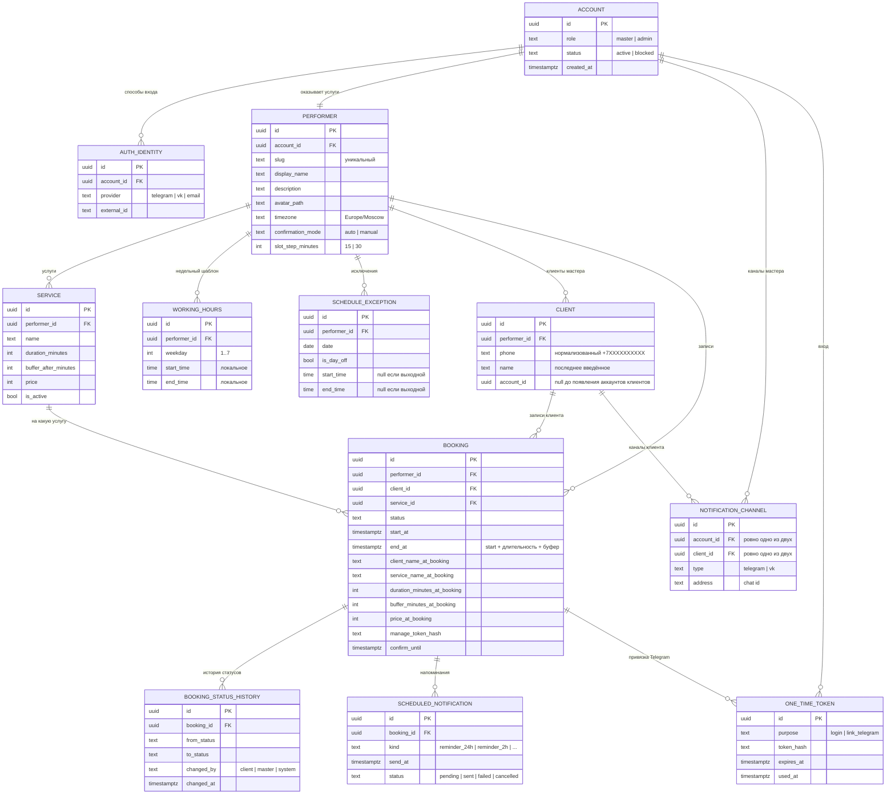

# Модель данных

Черновик сущностей для MVP. Все моменты времени хранятся в UTC (`timestamptz`), локальное время мастера только в шаблонах расписания.

## Диаграмма

## Решения, которые не видно на диаграмме

### Запись хранит снимок услуги
В записи сохраняются название, длительность, буфер и цена **на момент записи**. Ссылка `service_id` остаётся для статистики «какая услуга популярнее», но деньги и время берутся из снимка. Иначе повышение цены с 3000 до 3500 изменило бы прошлые записи, а смена длительности сдвинула бы `end_at` у уже существующих.

### Клиент уникален внутри мастера
Ключ: `(performer_id, phone)`, телефон нормализуется к единому формату. Один человек, записавшийся к двум мастерам, это две строки, и мастера не видят данных друг друга.
- Имя в записи хранится как введено (`client_name_at_booking`), в карточке клиента обновляется последним значением. Одинаковый телефон и другое имя не создают второго клиента (в семье один номер на двоих).
- Телефон никем не подтверждается, поэтому он контакт, а не идентификатор личности. Доступ к записи даёт только токен.
- В будущем `account_id` у клиента заполняется после входа через Telegram. Аккаунт связывает несколько клиентских строк у разных мастеров, телефон для этого не используется.

### Канал уведомлений: один владелец
У канала заполнено ровно одно из `account_id` и `client_id` (CHECK-ограничение). Это сохраняет целостность внешних ключей, в отличие от пары `owner_type` + `owner_id`.

### Статусы записи
`pending`, `confirmed`, `declined`, `cancelled_by_client`, `cancelled_by_master`, `expired`, `completed`.
Активные (занимают время): `pending`, `confirmed`. Каждый переход пишется в историю статусов.

### Ограничения на уровне БД
- `auth_identity`: уникальная пара `(provider, external_id)`.
- `performer`: уникальный `slug`, уникальный `account_id`.
- `client`: уникальная пара `(performer_id, phone)`.
- `schedule_exception`: уникальная пара `(performer_id, date)`.
- `booking`: exclusion constraint, запрещающий пересечение интервалов `[start_at, end_at)` у одного исполнителя среди активных записей (`EXCLUDE USING gist`, потребуется расширение `btree_gist`).
- Индексы: `booking (performer_id, start_at)`, `scheduled_notification (status, send_at)`.

### Расчёт свободного времени
1. Берём шаблон на день недели.
2. Применяем исключение на дату (оно сильнее шаблона).
3. Переводим локальные часы в UTC по часовому поясу мастера.
4. Вычитаем интервалы активных записей.
5. Предлагаем начала записи с шагом `slot_step_minutes`, если помещается `длительность + буфер`.

## Открытые вопросы
- Нужны ли «особые часы» в исключениях в MVP или хватит только выходных?
- Как показывать клиенту запись, у которой мастер сменил услугу (удалил или деактивировал)?
